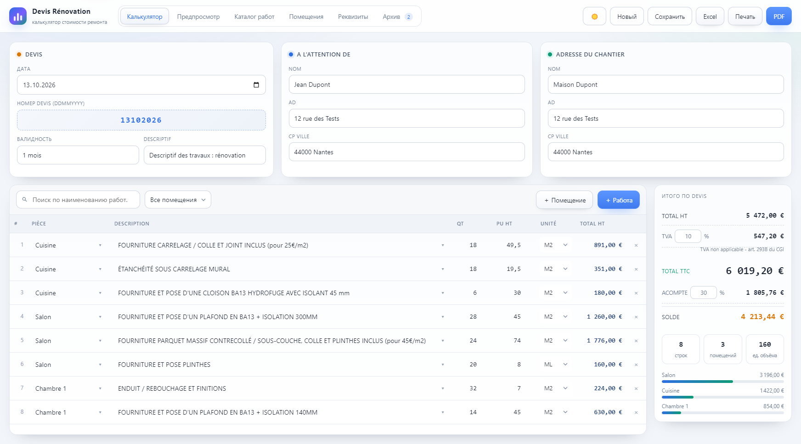
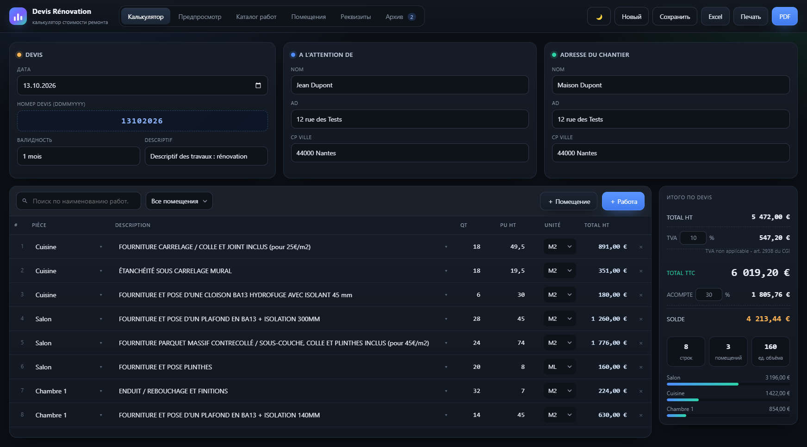
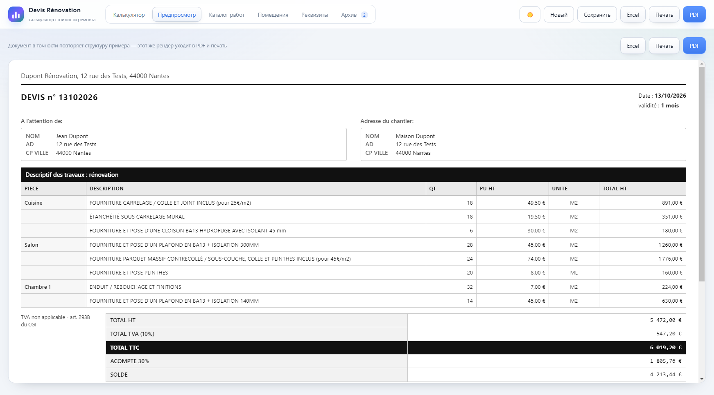
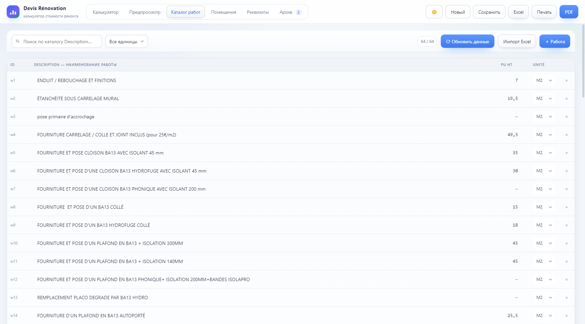

# Devis Rénovation

**Десктопный калькулятор стоимости ремонта и генератор коммерческих предложений (devis)** для французского рынка. Приложение на Electron: работает офлайн, данные хранятся локально на компьютере, никакого сервера.

Приложение собирает готовый документ-предложение по стандартной французской форме: строки сметы по помещениям, количество, цены, итоги с НДС (TVA) и авансом (acompte) — и сразу выгружает его в PDF, Excel или на печать.



## Назначение

Строительные бригады и подрядчики во Франции работают с формой **devis** (коммерческое предложение со сметой). Этот калькулятор автоматизирует её заполнение:

- каталог работ с ценами за единицу (м², погонный метр, штука);
- быстрая сборка сметы по помещениям (кухня, спальня, санузел…);
- автоматический пересчёт итогов: `TOTAL HT → TVA → TOTAL TTC → ACOMPTE → SOLDE`;
- документ, идентичный печатной форме, — тем же рендером идёт в PDF и печать.

## Основные функции

- **Каталог работ** — поиск, редактирование цен/единиц, импорт из Excel-файла (листы `Description` / `pièces` / `unités`)
- **Синхронизация с Google Таблицей** — правите прайс в таблице, в калькуляторе жмёте «Обновить данные»: новые работы добавляются, изменённые цены обновляются, показывается отчёт изменений
- **Калькулятор** — помещения, автоподстановка цены и единицы из фильтр-поиск, фильтры по помещениям, живые итоги и вкладка-диаграмма доли помещений
- **Предпросмотр devis** — точная копия французского бланка (A4)
- **Экспорт** — PDF (A4, `printToPDF`), Excel с живыми формулами (`=QT*PU`, `=SUM`, `%TVA`), печать; хоткеи `Ctrl+E` / `Ctrl+P`
- **Архив смет** — поиск по номеру/клиенту/адресу, повторное открытие, экспорт из архива, бейдж количества
- **Реквизиты компании** — шапка, условия оплаты, TVA/acompte по умолчанию, подпись документа
- **Светлая/тёмная тема**, автосохранение (`Ctrl+S`), создание новой сметы (`Ctrl+N`)

## Скриншоты

| Калькулятор (тёмная тема) | Документ-предложение |
|---|---|
|  |  |



## Установка

### Готовый установщик (на любой ПК, Node.js не нужен)

1. Соберите установщик (см. ниже) или возьмите готовый `Setup-Devis-Renovation-<версия>.exe`
2. Запустите его и следуйте мастеру установки
3. Запуск — ярлык «Devis Rénovation» на рабочем столе или в меню «Пуск»

Подробнее — в [ИНСТРУКЦИЯ-УСТАНОВКА.txt](ИНСТРУКЦИЯ-УСТАНОВКА.txt) (перенос на другой компьютер, поведение антивируса).

### Сборка из исходников

Требуется [Node.js](https://nodejs.org) LTS.

```bash
npm install     # зависимости
npm start       # запуск в режиме разработки
npm run dist    # сборка установщика → release/Setup-Devis-Renovation-<версия>.exe
```

## Как это устроено

- **Electron + чистый JavaScript** — без фреймворков; вся логика в `src/app.js`, разметка в `src/index.html`
- **Хранение** — единый `store.json` в `%APPDATA%` (каталог, настройки, архив смет); при первом запуске наполняется демо-каталогом из `src/seed-data.json`
- **Экспорт** — PDF/печать через скрытое окно и `printToPDF`, Excel через ExcelJS с формулами (`main.js`)
- **Сборка** — electron-builder (NSIS, x64); хук `tools/after-pack.js` гарантирует упаковку всех транзитивных зависимостей в `app.asar`

## Лицензия

MIT
